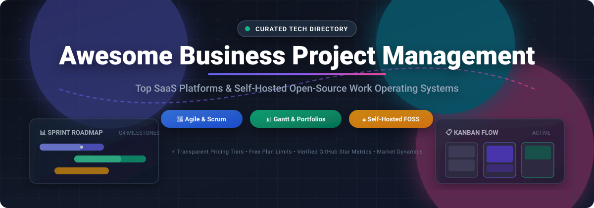

# 🚀 Awesome Business Project Management

  <strong>Curated directory of top-tier SaaS platforms and self-hosted open-source project management tools, Work OSs, agile issue trackers, and collaboration suites.</strong>

  
  
  
  
  
  
  

  🌟 Star if you find this repository valuable! 🌟

---

## 📑 Overview & Objectives

Looking for the best **project management software**, **agile sprint boards**, or **self-hosted task trackers** for your company? This comprehensive guide compares category-leading enterprise **SaaS work operating systems** with privacy-respecting, production-ready **open-source FOSS alternatives**.

Whether your team needs Kanban boards, Gantt chart scheduling, critical path method (CPM) planning, resource management, issue tracking, or relational database collaboration like Notion and Airtable, this directory provides:

- 💰 **Exact starting tier pricing** (no vague "custom pricing" quotes)
- 🎁 **Specific free tier and trial constraints** (user counts, storage caps, board limits)
- 🏢 **Company scale and valuation benchmarks** (ARR and market capitalizations)
- ⭐ **Real-time GitHub star ratings** linked directly to stargazer metrics
- 🔒 **Data sovereignty and self-hosting insights** for compliance and security

---

## 🧭 Table of Contents

- [📈 Sector Overview & Market Dynamics](#-sector-overview--market-dynamics)
- [☁️ SaaS & Hosted Work Operating Systems](#️-saas--hosted-work-operating-systems)
- [💻 Open-Source & Self-Hosted Alternatives](#-open-source--self-hosted-alternatives)
- [🛠️ Architectural Stacks & Custom Workflows](#️-architectural-stacks--custom-workflows)
- [🤝 How to Contribute](#-how-to-contribute)
- [💖 Support & Sponsorship](#-support--sponsorship)
- [📊 Star History](#-star-history)
- [⚖️ Disclaimer & Compliance](#️-disclaimer--compliance)

---

## 📈 Sector Overview & Market Dynamics

The global **Project Management Software (PMS)** and **Collaborative Work Management (CWM)** market is estimated at approximately **$7.5B to $9.8B in 2025–2026** and is projected to expand past **$15B by 2030** at an expected CAGR of 10–13%. 

The sector is **moderately fragmented** rather than winner-take-all:
- **Enterprise Consolidation**: Incumbents like **Atlassian** (Jira, Trello), **Blackstone/Smartsheet**, and **Monday.com** dominate cross-departmental portfolio governance, IT workflows, and Fortune 500 compliance deployments.
- **Workflow Specialization**: High fragmentation persists because modern teams operate under distinct functional philosophies:
  - *Engineering & Developer Teams* prioritize rapid cycle mechanics, bug tracking, and Git integrations (e.g., Jira, Plane).
  - *Creative & Marketing Agencies* favor visual boards, automated intake forms, and client proofing (e.g., Asana, Wrike, Monday.com).
  - *Modular & Knowledge-Centric Workspaces* center on relational databases, wikis, and doc-canvas hybrids (e.g., Notion Projects, Airtable, AppFlowy, AFFiNE).
- **The Self-Hosted Imperative**: Stricter data residency mandates (GDPR, HIPAA, SOC 2, CCPA) have driven a resurgence in modern open-source solutions like **OpenProject**, **Plane**, and **NocoDB**, giving engineering-led organizations uncompromised control over their intellectual property.

---

## ☁️ SaaS & Hosted Work Operating Systems

*Commercial SaaS platforms sorted in descending order by company valuation / market capitalization.*

| Platform 🏷️ | Company Size (Valuation / Revenue) 🏢 | Starting Paid Pricing 💵 | Free Tier / Free Trial Limits 🎁 | Key Strengths & Best For 🎯 |
| :--- | :--- | :--- | :--- | :--- |
| **[Jira](https://www.atlassian.com/software/jira)** | ~$35B Market Cap / $4.4B+ ARR *(Atlassian)* | $7.75/user/month *(Standard plan billed annually)* | Free forever for up to 10 users, 2 GB file storage, Scrum/Kanban boards, standard backlog | The de facto standard for agile software project management with robust sprint planning, backlog management, and massive marketplace. |
| **[Notion Projects](https://www.notion.com/)** | ~$10B Valuation / $300M+ ARR | $10/user/month ($8/user/month billed annually - Plus) | Free forever for individuals, unlimited blocks for individuals, up to 10 guest collaborators, 5 MB file upload limit | All-in-one modular workspace combining docs, relational databases, roadmaps, and sprint views in a flexible wiki-style canvas. |
| **[Smartsheet](https://www.smartsheet.com/)** | ~$8.4B Valuation *(Acquired by Blackstone/Vista)* / $1B+ ARR | $9/user/month ($7/user/month billed annually - Pro) | 30-day free trial with full Pro features; no permanent free tier | Spreadsheet-native enterprise work execution and Gantt platform built for complex operational workflows and portfolio tracking. |
| **[Monday.com](https://monday.com/)** | ~$8.0B Market Cap / $950M+ ARR | $12/seat/month ($9/seat/month billed annually - Basic, min 3 seats) | Free forever for up to 2 seats, 3 boards, 200+ templates, 8 column types, 500 MB storage | Highly customizable, visual Work OS with automations, custom dashboards, and cross-functional team workflows. |
| **[Airtable](https://airtable.com/)** | ~$5B Valuation / $350M+ ARR | $24/seat/month ($20/seat/month billed annually - Team) | Free forever for up to 5 editors, 1,000 records per base, 1 GB attachment space per base, unlimited bases | Spreadsheet-database hybrid offering multidimensional views (Kanban, Grid, Calendar, Gallery) for data-driven operations. |
| **[ClickUp](https://clickup.com/)** | ~$4B Valuation / $200M+ ARR | $10/user/month ($7/user/month billed annually - Unlimited) | Free forever with unlimited tasks and members, 100 MB cloud storage, 100 uses of custom fields, collaborative docs | Consolidates tasks, whiteboards, docs, dashboards, chat, and goal tracking into an all-in-one productivity suite. |
| **[Asana](https://asana.com/)** | ~$3B Market Cap / $700M+ ARR | $13.49/user/month ($10.99/user/month billed annually - Starter) | Free forever for up to 10 teammates, unlimited tasks, unlimited projects, unlimited messages, 100 MB per file limit | Elegant cross-team work management with timeline/Gantt views, project portfolios, and workload capacity balancing. |
| **[Trello](https://trello.com/)** | Atlassian Subsidiary (Acquired for $425M) | $6/user/month ($5/user/month billed annually - Standard) | Free forever for unlimited users, up to 10 workspace boards, unlimited power-ups per board, 10 MB per file attachment | Intuitive, lightweight Kanban board platform designed for quick, visual task and personal workflow management. |
| **[Wrike](https://www.wrike.com/)** | ~$2B+ Valuation *(Symphony Technology Group)* / $200M+ ARR | $10/user/month ($9.80/user/month billed annually - Team) | Free forever for unlimited users, basic task management, subtask handling, 2 GB storage; 14-day trial for premium tiers | Enterprise-grade project and resource management with interactive Gantt charts, proofing, and request intake forms. |
| **[Basecamp](https://basecamp.com/)** | Bootstrap / $50M–$100M ARR *(37signals)* | $15/user/month *(pay-as-you-go)* or $299/month flat *(unlimited users - Pro Unlimited)* | 30-day free trial with full features and unlimited users; no permanent free tier | Opinionated, flat-rate team communication and project collaboration suite with to-dos, message boards, and automated check-ins. |

---

## 💻 Open-Source & Self-Hosted Alternatives

*Self-hosted open-source GitHub projects sorted in descending order by GitHub star count.*

| Project 📦 | License 📜 | Tech Stack ⚙️ | Highlights & Capabilities 🌟 |
| :--- | :--- | :--- | :--- |
| **[AppFlowy](https://github.com/AppFlowy-IO/AppFlowy)**  | AGPL-3.0 | Flutter, Rust | Open-source Notion and Airtable alternative for projects, wikis, and databases with complete offline-first architecture and end-to-end data control. |
| **[AFFiNE](https://github.com/toeverything/AFFiNE)**  | MIT | TypeScript, Rust | Next-gen workspace combining docs, visual mind-mapping canvas, and project database blocks into a unified multimodal canvas. |
| **[NocoDB](https://github.com/nocodb/nocodb)**  | AGPL-3.0 | Node.js, Vue.js | Open-source Airtable alternative that connects to any relational database (PostgreSQL, MySQL, SQLite) to provide instant spreadsheet and Kanban project views. |
| **[Plane](https://github.com/makeplane/plane)**  | AGPL-3.0 | TypeScript, Next.js, Python | Modern, fastest-growing open-source Jira alternative with issues, cycles (sprints), modules, roadmaps, analytics, and rich-text docs with AI capabilities. |
| **[Focalboard](https://github.com/mattermost-community/focalboard)**  | MIT | Go, React, TypeScript | Self-hosted project management tool alternative to Trello, Notion, and Asana; native integration with Mattermost team channels. |
| **[Wekan](https://github.com/wekan/wekan)**  | MIT | Meteor, Node.js | Pure open-source Trello clone featuring drag-and-drop Kanban boards, swimlanes, card covers, checklists, and automated board rules. |
| **[OpenProject](https://github.com/opf/openproject)**  | GPL-3.0 | Ruby on Rails, PostgreSQL | The most complete open-source enterprise alternative to Jira and MS Project; includes interactive Gantt charts, Scrum/Kanban, cost reporting, budget tracking, and BIM/BCF views. |
| **[Planka](https://github.com/plankanban/planka)**  | AGPL-3.0 | React, Redux, Node.js | Real-time elegant Kanban board for workgroups and individuals with card timers, attachments, markdown descriptions, and notification systems. |
| **[Leantime](https://github.com/Leantime/leantime)**  | AGPL-3.0 | PHP, MySQL | Strategy-first project management system designed for non-project managers, linking daily tasks directly to OKRs, lean canvases, and milestones. |
| **[Kanboard](https://github.com/kanboard/kanboard)**  | MIT | PHP, SQLite / PostgreSQL | Minimalist, single-purpose visual task manager prioritizing zero configuration overhead, speed, task automation, and plugin extensibility. |
| **[Redmine](https://github.com/redmine/redmine)**  | GPL-2.0 | Ruby on Rails | Veteran, highly dependable project management and bug tracking system with multi-project support, subprojects, Gantt charts, role-based access, and hundreds of community plugins. |
| **[Vikunja](https://github.com/go-vikunja/vikunja)**  | AGPL-3.0 | Go, Vue.js | High-performance, flexible to-do and project management application with Kanban, list, table, and Gantt views, recurring tasks, and CalDAV synchronization. |
| **[Taiga](https://github.com/taigaio/taiga-docker)**  | MPL-2.0 / AGPL-3.0 | Python (Django), AngularJS | Purpose-built agile project management platform for Scrum and Kanban teams, featuring dedicated sprint mechanics, story points, epics, and burndown charts. |
| **[Restyaboard](https://github.com/RestyaPlatform/board)**  | OSL-3.0 | PHP, PostgreSQL | Visual workflow and Kanban board platform with mind mapping, list, calendar, and grid views, chat integrations, and offline support. |

---

## 🛠️ Architectural Stacks & Custom Workflows

For teams building resilient internal productivity stacks without vendor lock-in:
- **Enterprise Engineering**: Pair **[OpenProject](https://github.com/opf/openproject)** (governance, portfolio timelines, and budget tracking) with **[Plane](https://github.com/makeplane/plane)** (developer sprint backlogs and Git commit linking).
- **Pure Scrum Execution**: Deploy **[Taiga](https://github.com/taigaio/taiga-docker)** for ceremonial Scrum boards, story estimation points, and burndown velocity reporting.
- **Data & Relational Operations**: Integrate **[NocoDB](https://github.com/nocodb/nocodb)** or **[AppFlowy](https://github.com/AppFlowy-IO/AppFlowy)** for custom spreadsheets, inventory-linked tasks, and client databases.
- **Strategy & Milestone Alignment**: Utilize **[Leantime](https://github.com/Leantime/leantime)** for non-technical leadership wanting direct connection between OKRs, lean research canvases, and delivery milestones.

---

## 🤝 How to Contribute

Contributions are wholeheartedly welcomed! To propose new tools or update pricing and metrics:

1. 🍴 Fork this repository.
2. 🌿 Create a feature branch: `git checkout -b feature/add-new-pm-tool`.
3. 📝 Update `README.md` following the established table structure, ensuring prices are specific and badges use `style=social&color=white`.
4. 🚀 Push your branch and open a Pull Request with a clear description of your changes.

---

## 💖 Support & Sponsorship

If you find this curated directory useful for evaluating software or discovering open-source alternatives, please consider showing your support:

- ⭐ **Star this repository** to help others discover it across GitHub.
- 🍴 **Fork and share** with your engineering, DevOps, and product management networks.
- ☕ **Buy a coffee & sponsor**: Support ongoing research, open-source maintenance, and curation via the [GitHub Sponsors Dashboard](https://github.com/sponsors/ishandutta2007).

Every contribution helps keep this directory updated, transparent, and community-driven! 🙏

---

## 📊 Star History

---

## ⚖️ Disclaimer & Compliance

- This repository is a **community-curated index** created for informational and architectural evaluation purposes; inclusion does not constitute commercial endorsement.
- All trademarks, logos, and brand names belong to their respective corporate owners.
- When deploying project management tools handling sensitive business records, customer communications, or proprietary source code, ensure full compliance with internal governance policies and data privacy regulations (**GDPR**, **CCPA**, **HIPAA**, and **SOC 2**).
- For self-hosted open-source software, ensure automated database backups, TLS encryption, and timely vulnerability patching before running production workloads.

---

  Maintained with ❤️ by <a href="https://github.com/ishandutta2007">Ishan Dutta</a> and the global open-source community.

